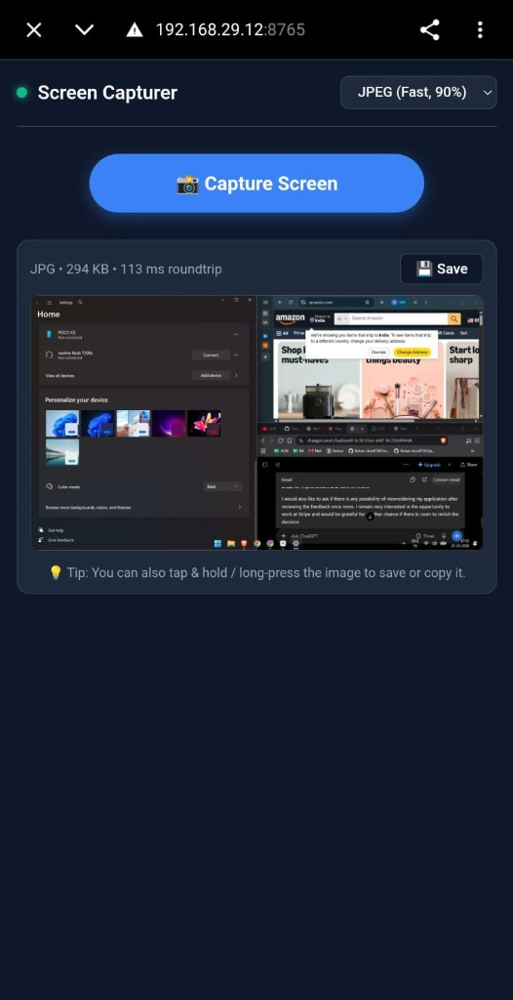
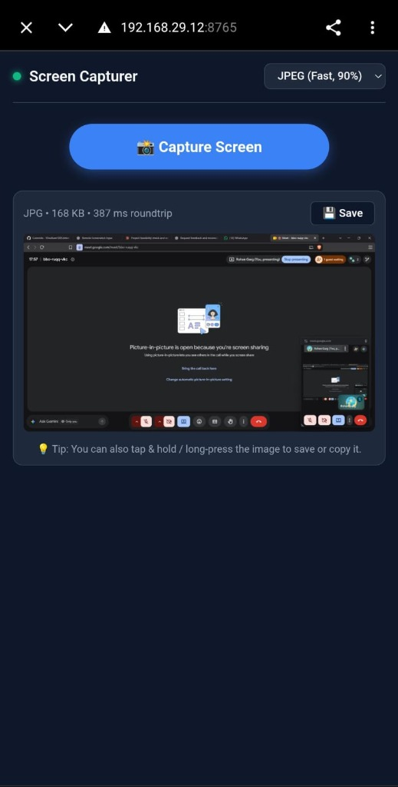

# ScreenCapturer 📸

A lightweight cross-platform utility for Windows 10/11 & macOS that lets you capture your laptop's screen directly from your phone — **over local Wi-Fi OR over cellular data (4G/5G) from anywhere** via built-in Cloudflare Quick Tunnels, **plus instant remote workstation locking (Win + L)** directly from your phone!

No accounts, no router configuration, no port forwarding, no video recording, no background polling, and 0% CPU while idle.

---

## 🚀 Quick Start (No Go or Coding Required!)

You **do NOT** need to install Go, Node.js, or any programming tools. Download the pre-built package for your OS:

### 1. Download
👉 **[Go to GitHub Releases v1.1.0](https://github.com/Rohan-droid7/ScreenCapturer/releases/latest)**

- **Windows 10 / 11:** Download `ScreenCapturer-v1.1.0-windows-amd64.zip`
- **macOS (Apple Silicon M1/M2/M3/M4):** Download `ScreenCapturer-v1.1.0-darwin-arm64.zip`
- **macOS (Intel):** Download `ScreenCapturer-v1.1.0-darwin-amd64.zip`

---

### 2. Start ScreenCapturer

#### On Windows:
- Extract the zip and double-click **`screencap.exe`**.
- Your web browser will automatically open showing your pairing dashboard.
- *(If Windows Defender Firewall prompts you, check **Private networks** and click **Allow access**).*

#### On macOS:
- Extract the zip.
- Open Terminal in the extracted folder and run:
  ```bash
  chmod +x screencap stop.sh
  ./screencap
  ```
- Your default browser (Safari/Chrome) will open showing your pairing dashboard.
- *(Note: On first launch, macOS will prompt you to grant **Screen Recording** permission in System Settings ➔ Privacy & Security).*

---

### 3. Connect & Capture from Your Phone

You have **two seamless connection modes**:

#### 📶 Mode A: Same Wi-Fi (Ultra Fast • 20ms Latency)
1. Ensure your phone is connected to the same Wi-Fi as your computer.
2. Select the **📶 Same Wi-Fi** tab on your pairing dashboard.
3. Scan the QR code with your phone camera and tap **Capture**.

#### 🌐 Mode B: Anywhere / Cellular (Cloudflare Tunnel)
1. No shared Wi-Fi needed! Works over phone mobile data (4G/5G), coffee shop Wi-Fi, or college networks.
2. Select the **🌐 Anywhere / Cellular** tab on the dashboard.
3. Scan the Cloudflare HTTPS QR code (`https://xxx.trycloudflare.com`) with your phone.
4. Tap **Capture** — end-to-end encrypted screen delivery over the internet.

---

### 🔒 Remote "Boss / Panic" Lock (Win + L from Phone)

Left your computer unlocked at your desk, in a library, coffee shop, or someone suddenly walks up to your desk?

- Tap the red **`🔒 Lock PC`** button on your mobile screen.
- ScreenCapturer instantly triggers `LockWorkStation` on Windows (equivalent to pressing **`Win + L`**) or displaysleep on macOS.
- Session is securely locked right away — without touching your laptop keyboard!


---

### 📋 2-Way Clipboard Sync (Phone ⇄ Laptop)

Effortlessly bridge your phone and computer without messaging apps or email drafts:

- **📥 Get PC Clipboard:** Tap to grab whatever text, URL, or code snippet is currently copied on your laptop. Includes a one-tap **Copy on Phone** option.
- **📤 Send to PC:** Type or paste text on your phone and tap **Send to PC** — it is immediately placed on your laptop's system clipboard, ready to paste with **Ctrl + V**!
<p align="center">
  
  &nbsp;&nbsp;&nbsp;&nbsp;
  
</p>

---

### 4. How to Turn It Off
When you are done, shut down the app anytime:
- **From your browser:** Click the red **"🛑 Turn Off ScreenCapturer"** button at the bottom of the pairing page.
- **On Windows:** Double-click **`stop.bat`** or click **Exit** in the System Tray.
- **On macOS:** Run `./stop.sh` or press `Ctrl + C` in Terminal.

---

## 🧠 How It Works

ScreenCapturer uses an on-demand, event-driven architecture that only takes a screenshot at the exact moment your phone requests one:

```
┌────────────────────────┐                  ┌──────────────────────────────────────────────┐
│  Mobile Phone (Client) │                  │          Windows / macOS Laptop Host         │
│                        │                  │                                              │
│ Tap Capture (Wi-Fi/WAN)├─────────────────►│ 1. Validate Bearer Token & Host Header      │
│                        │  POST /capture   │ 2. Check 5-attempt/60s IP Lockout            │
│                        │                  │ 3. Acquire Screen Capture Mutex              │
│                        │                  │ 4. BitBlt + GetDIBits on Input Desktop (GDI) │
│                        │                  │ 5. In-place BGRA-to-RGBA Translation         │
│                        │                  │ 6. Fast Encode (JPEG 90% or PNG BestSpeed)   │
│ Display Image on Phone │◄─────────────────┤ 7. Direct HTTP Response + FreeOSMemory()     │
└────────────────────────┘   Image Stream   └──────────────────────────────────────────────┘
```

1. **Native Capture**: Captures pixels directly using Win32 GDI APIs (`BitBlt` + `GetDIBits`) on Windows and CoreGraphics via `purego` on macOS.
2. **Cloudflare Quick Tunnels**: Establishes an encrypted, zero-config HTTPS outbound tunnel without exposing ports or opening router firewalls.
3. **Full Resolution DPI-Aware**: Uses Per-Monitor V2 awareness so screenshots are captured at native physical resolution even with display scaling.
4. **Zero-Copy Memory Swap**: Converts BGRA directly to RGBA in memory without buffer duplication.
5. **Self-Contained Executable**: All web assets (HTML/CSS/JS) and pairing dashboards are embedded directly inside the binary.

---

## ⚙️ Advanced Details & Troubleshooting

<details>
<summary><b>🛠️ Building from Source (For Developers)</b></summary>

If you have Go installed and want to build the executable yourself:

```powershell
# 1. Clone repository
git clone https://github.com/Rohan-droid7/ScreenCapturer.git
cd ScreenCapturer

# 2. Build production GUI binary (silent background window)
go build -ldflags "-H=windowsgui -s -w" -o screencap.exe ./cmd/screencap

# Or build with interactive console logging:
go build -o screencap.exe ./cmd/screencap
```
</details>

<details>
<summary><b>🛡️ Security & Privacy</b></summary>

- **Token-Based Authentication**: A 32-byte cryptographically random token is generated on first launch and stored in `%APPDATA%\ScreenCapturer\config.json`.
- **Safe Fragment Passing**: The token is delivered via URL fragment (`#token=...`), preventing it from ever being sent in plain HTTP request headers, browser history, or server access logs.
- **Brute Force Lockout**: 5 failed token attempts locks the offending client IP out for 60 seconds.
- **End-to-End Encryption**: When using the Cloudflare mode, all communication between phone and laptop is fully encrypted via TLS (HTTPS).
</details>

---

## 📄 License
MIT License.
